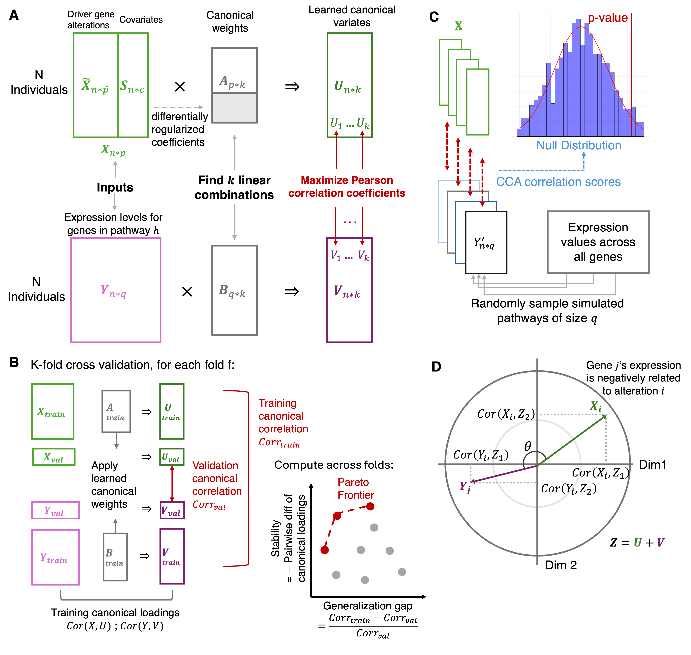

# PathwayCCA
PathwayCCA is a framework for pathway-level association analysis between multi-omic driver alterations and gene-set expression programs. The framework extends regularized Canonical Correlation Analysis (RCCA) and tests whether multiple somatic alterations jointly affect the expression of a given pathway. To address confounding from categorical covariates, we introduce group-weighted regularized CCA (GW-RCCA) an extension of RCCA that penalizes driver alterations and covariates separately. The covariates, such as cancer-subtype indicators, get stronger regularization, which keeps them from dominating the canonical variates. Penalty strengths are chosen by cross-validation using a Pareto criterion that balances stability against overfitting. We further develop a novel sampling-based hypothesis test that mitigates the effect of spurious correlations common in high-dimensional data.

<p align="center">
  
</p>

The repository provides a complete implementation of Regularized CCA (RCCA), Constrained CCA (CCCA) (archived), Group-weighted regularized CCA (GW-RCCA) and the proposed PathwayCCA framework with resampling-based hypothesis test. 

## Installation

### Requirements

PathwayCCA is a pure-Python package with no compiled code, so it is platform-independent (Linux, macOS, Windows); it has been tested on macOS. It requires Python 3.9 or later and the following packages, which `pip` installs automatically. Both the minimum and the latest versions below were tested:

| Dependency | Minimum version | Latest version tested |
|---|---|---|
| Python | 3.9 | 3.13 |
| numpy | 1.21 | 2.5 |
| scipy | 1.7 | 1.18 |
| scikit-learn | 1.0 | 1.9 |
| pandas | 1.4 | 3.1 |
| matplotlib | 3.5 | 3.11 |
| seaborn | 0.11 | 0.13 |

Optional: `jupyter` to run the example notebook. You also need `git` to install from GitHub or clone the repository.

### Option 1: Install with pip from GitHub

```bash
pip install git+https://github.com/Singh-Lab/PathwayCCA.git
```

### Option 2: Clone the repository (to run the example notebook)

Cloning downloads the example data (about 100 MB).

```bash
git clone https://github.com/Singh-Lab/PathwayCCA.git
cd PathwayCCA
pip install -e ".[examples]"
```

`-e` installs in editable mode, so changes to the source code take effect without reinstalling. `[examples]` also installs Jupyter.

### Option 3: Install into a new conda environment

We recommend a separate environment to avoid conflicts with other packages:

```bash
conda create -n pathwaycca python=3.11
conda activate pathwaycca
pip install git+https://github.com/Singh-Lab/PathwayCCA.git
```

Or with Python's built-in `venv`:

```bash
python3 -m venv pathwaycca-env
source pathwaycca-env/bin/activate      # on Windows: pathwaycca-env\Scripts\activate
pip install git+https://github.com/Singh-Lab/PathwayCCA.git
```

### Verify the installation

```python
import numpy as np
import pathwaycca

print(pathwaycca.__version__)

rng = np.random.default_rng(0)
X = rng.normal(size=(50, 5))   # 3 driver features + 2 covariates
Y = rng.normal(size=(50, 8))   # 8 pathway genes
A, B, r, r_emp = pathwaycca.solve_prcca_x(
    X, Y, idx_x1=[0, 1, 2], idx_x2=[3, 4],
    lambda_x1=1, lambda_x2=1000, lambda_y=1, n_components=2,
)
print(r_emp)   # two canonical correlations
```

If this prints the version number and two correlations, the installation works. Installation typically takes under a minute.

### Running the example notebook

After Option 2, start Jupyter from the repository folder and open `example_code/pathwaycca_prcca_example_code.ipynb`:

```bash
jupyter notebook
```

### Uninstall

```bash
pip uninstall pathwaycca
```

## PathwayCCA Source Code
`pathwaycca/prcca_x.py`
- Implements `solve_prcca_x` which solved CCA with group-weighted regularization, allowing users to force stronger regularization on some of the variables.
- Implements `pareto_select` and `cv_prcca_pareto` which uses cross validation and pareto frontier to select optimal parameters in a log-scale parameter space

`pathwaycca/constrained_cca.py` (archive): 
- Implements `ccca`, which solves CCA under user-specified linear constraints on one coefficient set as proposed in the paper. 
- Provides `solve_ccca`, a wrapper that runs the solver and returns a structured result object.

`pathwaycca/plot_cca.py`:
- Contains visualization functions for examining CCA results:
  - `plt_var`: plots correlation-circle plots that shows canonical loadings of variables (with respect to the symmetric latent canonical variate $$Z=U+V$$).
  - `plt_indiv`: plots sample projections on canonical variates.
  - `plt_cca`: a wrapper that can contain both visulization plots.

`pathwaycca/significance_test.py`
- Implements `calculate_p_value_prcca_x`, which performs resampling-based significance testing to assess the statistical strength of canonical correlations.

## Example Data and Code

### Example Inputs:

`input_data/pathway_db/msigdb_H_P53.csv` constains an example pathway gene set metadata. 

`input_data/BRCA_subset/` contains a set of example input data that are small subsets of the preprocessed data from the `TCGA-BRCA` dataset used in the paper

### Example code:

We offer a simple example code for the user to experiment with PathwayCCA in `pathwaycca_prcca_example_code.ipynb` using the provided example input data. Note that the outputs may differ slightly from those reported in the paper because the example input data are only subsets of the original dataset (due to GitHub storage limits).
